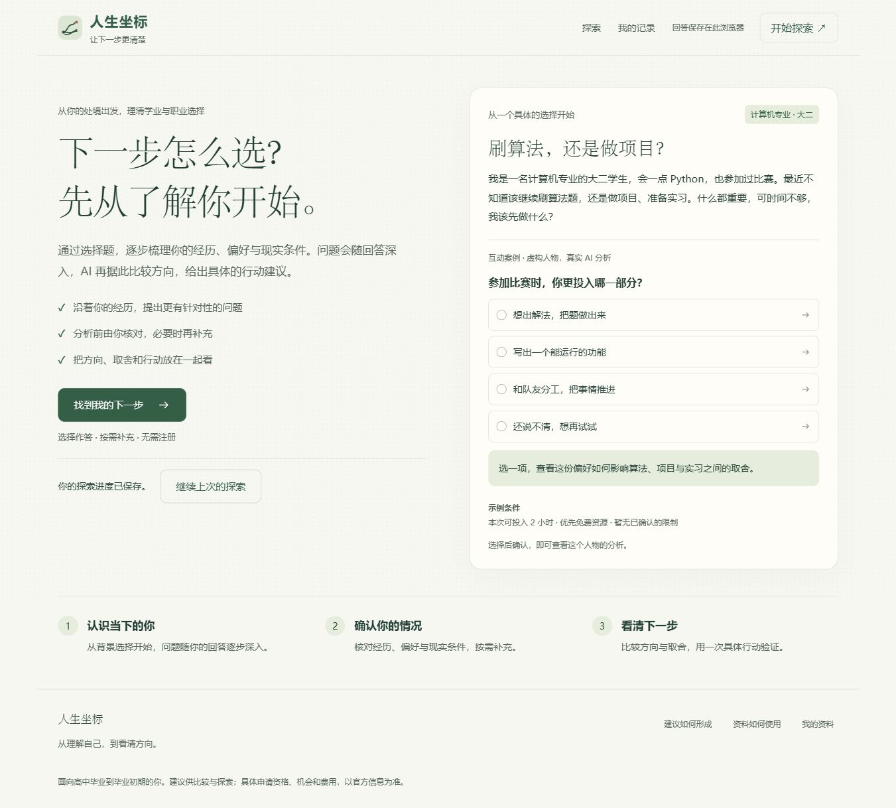
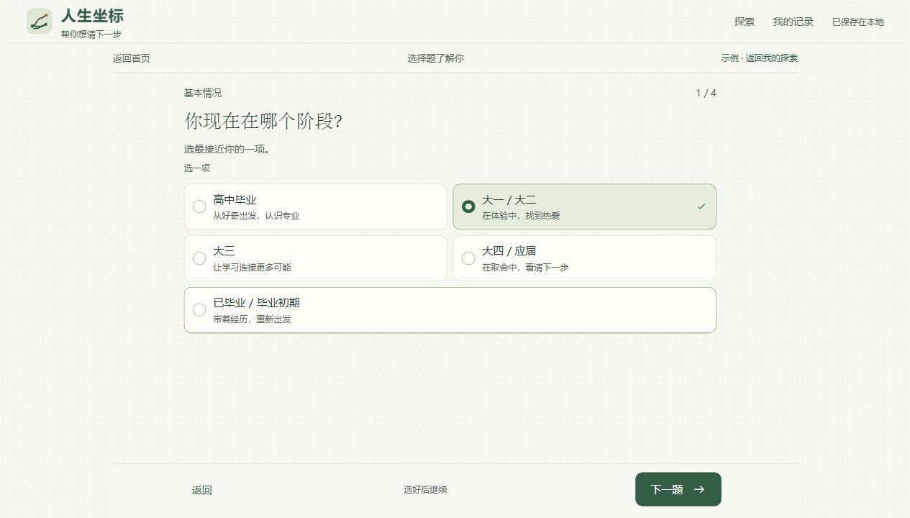
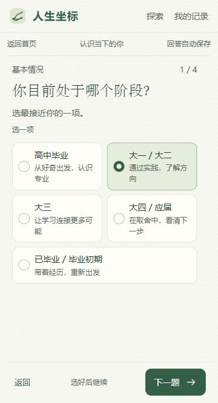
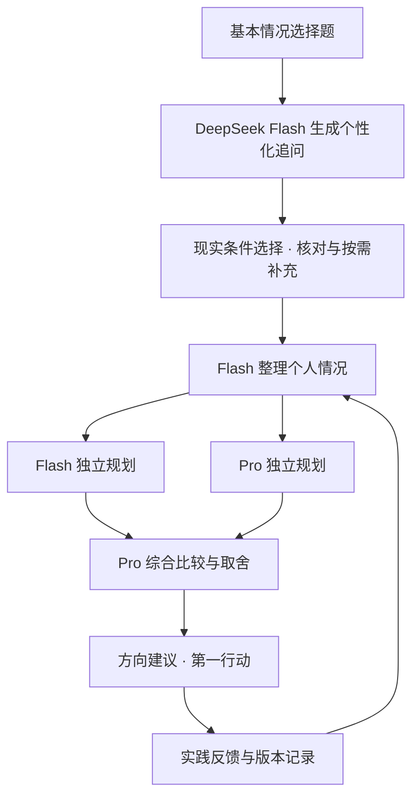

<p align="center">
  <a href="https://life.wolfx.top"></a>
</p>

<h1 align="center">人生坐标 · Life Coordinate</h1>

<p align="center"><strong>下一步怎么选？先从了解你开始。</strong></p>
<p align="center">用个性化选择题梳理背景、经历与现实条件，<br>再由 AI 比较选择，找到现在能做的下一步。</p>

<p align="center">
  <a href="https://life.wolfx.top"><strong>在线体验 ↗</strong></a> ·
  <a href="#从一个真实困惑开始">看看案例</a> ·
  <a href="#快速开始">本地运行</a> ·
  <a href="#系统如何工作">系统架构</a> ·
  <a href="https://github.com/wolfgang008/life-coordinate/issues">反馈问题</a>
</p>

<p align="center">
  <a href="https://github.com/wolfgang008/life-coordinate/actions/workflows/ci.yml"></a>
  
  
  
</p>

[](https://life.wolfx.top)

<p align="center"><sub>真实产品截图 · 2026-11-01 线上版本 · 无需注册即可开始</sub></p>

## 先了解你，建议才有依据

选专业、安排大学生活、准备实习、探索职业方向——很多时候，困难在于还没理清自己的处境，也不知道应该向 AI 提供哪些信息。

**人生坐标把这一步做成了有引导的选择题。** 先了解你所处的阶段、正在纠结的事与已有经历，再根据回答生成个性化追问。你核对自己的情况，补充遗漏，最后得到结合时间、资源和现实限制的建议。

| 你需要的帮助 | 人生坐标怎么做 |
| --- | --- |
| 不知道从哪里说起 | 从基本情况选择题开始，不用先写长篇自我介绍 |
| 希望问题和自己有关 | AI 根据前面的回答继续出题，了解具体经历与投入偏好 |
| 有实际限制需要考虑 | 把可投入时间、费用或收入压力、不能接受的事纳入分析 |
| 想知道下一步做什么 | 比较方向、代价和调整条件，给出可以实际完成的小行动 |
| 试过之后情况变了 | 保留记录，用行动反馈更新下一版建议 |

## 从一个真实困惑开始

> 我是一名计算机专业的大二学生，会一点 Python，也参加过比赛。最近不知道该继续刷算法题，还是做项目、准备实习。什么都重要，可时间不够，我该先做什么？

同样是计算机学生，参加比赛时最投入的部分也可能不同：有人喜欢想出解法，有人喜欢把功能做出来，有人擅长和队友推进事情。

人生坐标先通过选择题了解这些差别，再结合当前基础和可投入时间比较选择。首页的 **「用这个案例体验选择题」** 会进入实际流程，经过背景选择、AI 追问、核对补充和分析。案例只预填虚构背景，时间与现实边界仍由体验者选择。

**首页展示的追问明确标为示意；进入流程后的个性化问题由 AI 实际生成。**

## 一次探索，怎样走完

| 步骤 | 你会做什么 | 得到什么 |
| :---: | --- | --- |
| **01** | 选择阶段、困扰、领域与当前状况 | 一份基本背景 |
| **02** | 回答 AI 根据背景生成的个性化选择题 | 更具体的经历和偏好线索 |
| **03** | 选择现实边界、可用支持与投入时间 | 建议必须考虑的条件 |
| **04** | 核对摘要；按需补充背景选择题或一句文字 | 由你核对的信息基础，补充均可跳过 |
| **05** | 确认生成建议，比较不同方向 | 取舍理由、风险、下一步行动与调整条件 |
| **06** | 完成一次尝试，记录感受与结果 | 用真实反馈更新建议，保留旧版本 |

<table>
  <tr>
    <td width="69%" valign="top"></td>
    <td width="31%" valign="top"></td>
  </tr>
  <tr>
    <td align="center"><sub>一题一屏，下一题始终可见</sub></td>
    <td align="center"><sub>手机上也能顺畅选答</sub></td>
  </tr>
</table>

常规题在一屏内完成；遇到长内容或矮屏时，只滚动中间的题目区域，底部操作区保持可见。补充背景同样逐题展示，换题后回到内容顶部。

## 系统如何工作



所有模型请求由后端发送至 **DeepSeek 官方 API**。两次独立规划使用同一份个人情况，形成完整方案后，再由 Pro 发起新请求进行综合比较。

| 环节 | 后端模型标识 | 职责 |
| --- | --- | --- |
| 个性化出题、背景理解、反馈更新 | `deepseek-flash` | 整理已知信息与需要了解的差别 |
| 两份独立规划 | `deepseek-flash` + `deepseek-v4-pro` | 分别提出方向、条件、风险与行动 |
| 综合建议 | `deepseek-v4-pro` | 比较完整方案，给出取舍与可执行的下一步 |

模型返回内容会经过结构、来源、时间预算和现实边界校验。未被用户确认的推测会保留不确定性；调用失败会明确提示并保留回答，不用静态案例冒充实时结果。

前端使用原生 **HTML / CSS / ES Modules**；**Cloudflare Worker** 提供页面、API 和 NDJSON 进度流；**D1** 保存临时会话与任务状态。

## 快速开始

需要 **Node.js 22.13+**、npm，以及自己的 DeepSeek 官方 API 密钥。

```bash
git clone https://github.com/wolfgang008/life-coordinate.git
cd life-coordinate
npm ci
npm run build
```

独立本地预览无需 Cloudflare 账号。真实 AI 模式支持环境变量 `API_KEY`，也可在忽略目录 `.local/` 中创建 `deepseek.json`：

```json
{
  "apiBase": "https://api.deepseek.com",
  "apiKey": "YOUR_DEEPSEEK_API_KEY"
}
```

```powershell
# Windows PowerShell
$env:ENABLE_LIVE_AI="1"
node scripts/preview.mjs
```

```bash
# macOS / Linux
ENABLE_LIVE_AI=1 node scripts/preview.mjs
```

打开 **http://127.0.0.1:8788**。本地数据库会自动初始化。若只想浏览界面，可省略 `ENABLE_LIVE_AI`；真实 AI 分析仍需配置密钥。

使用 Wrangler 开发、设置 `.dev.vars` 和独立部署，见 [开发与部署指南](docs/development.md)。

## 验证与可靠性

```bash
npm test
npm run build
```

**本次发布前：122 项检查通过，28 项静态资源构建成功。** CI 会在推送和拉取请求中重新安装依赖、运行测试并构建；上方状态徽章显示最近的实际结果。

- **业务流程**：五个阶段、动态追问、可选补充、资料核对、建议与行动反馈。
- **建议约束**：时间预算、收入要求、家庭责任与其他现实边界。
- **异常恢复**：模型超时、无效返回、失败重试、取消、旧记录与迟到结果保护。
- **状态安全**：匿名会话隔离、重复请求防护、多标签页冲突与本地保存。
- **浏览器实测**：桌面与手机尺寸下的首页、选答和操作区；长内容与矮屏的滚动边界。

DeepSeek 真实联调与自动测试分别记录。此次上线后的核验逐文件比对了正式域名的全部 28 项静态资源，并检查 AI 配置与 D1 绑定；配置就绪不代表这次额外跑过生产环境付费分析。

[本次发布记录](qa/线上部署_2026-11-01.md) · [线上资源核验](qa/cloudflare-deploy-20261101.json) · [答题与滚动实测](qa/答题滚动修复_2026-11-01.md) · [选择题流程验收](qa/选择题主流程调整_2026-11-01.md)

## 数据与隐私

回答、建议和行动笔记保存在当前浏览器，可以导出。用户同意后，当次回答才会发给 DeepSeek；后端临时保存约 24 小时，用于会话与任务恢复。换设备不会自动同步本地记录。

密钥仅由后端持有，不进入前端代码、截图或仓库。`.dev.vars`、`.local/`、`.wrangler/` 和本地数据库均不纳入 Git。请勿在回答中填写姓名、电话或详细住址。

## 项目导航

| 目录 | 内容 |
| --- | --- |
| [`public/app/`](public/app/) · [`public/views/`](public/views/) | 页面交互、状态与各步骤视图 |
| [`public/domain/`](public/domain/) · [`public/styles/`](public/styles/) | 动态题、校验规则与响应式样式 |
| [`src/profiling/`](src/profiling/) · [`src/ai.mjs`](src/ai.mjs) | 个性化出题、背景理解与 DeepSeek 编排 |
| [`src/worker.mjs`](src/worker.mjs) · [`migrations/`](migrations/) | API、会话与数据库结构 |
| [`scripts/`](scripts/) · [`qa/`](qa/) | 构建、测试、预览与验收证据 |
| [`docs/development.md`](docs/development.md) | 本地开发、私密配置与独立部署 |

<details>
<summary><strong>团队与历史材料</strong></summary>

AI 软件赛道 · **老登与小登的奇妙之旅**<br>
队长：房刚毅 · 队员：李喜军 · 仓库维护：[@wolfgang008](https://github.com/wolfgang008)

[历史参赛材料](submission/README.md) · [宣传片与附件](https://github.com/wolfgang008/life-coordinate/releases/tag/promo-2026-10-04)

历史材料记录当时版本，当前产品流程和模型方案以本文及现行源码为准。

</details>

---

<p align="center"><strong>先选几道题，让下一步更清楚。</strong><br><br><a href="https://life.wolfx.top">开始探索 ↗</a></p>
